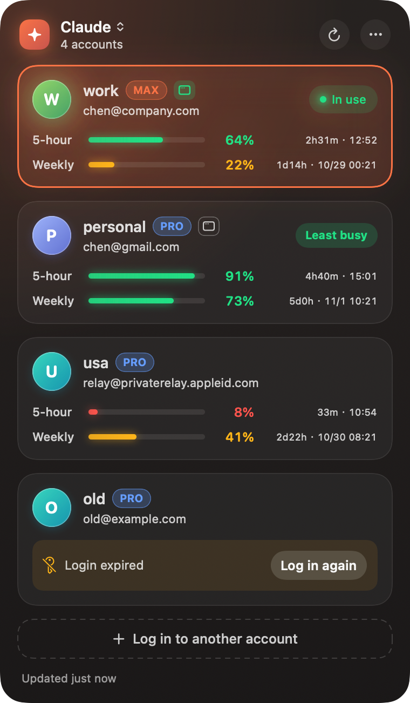
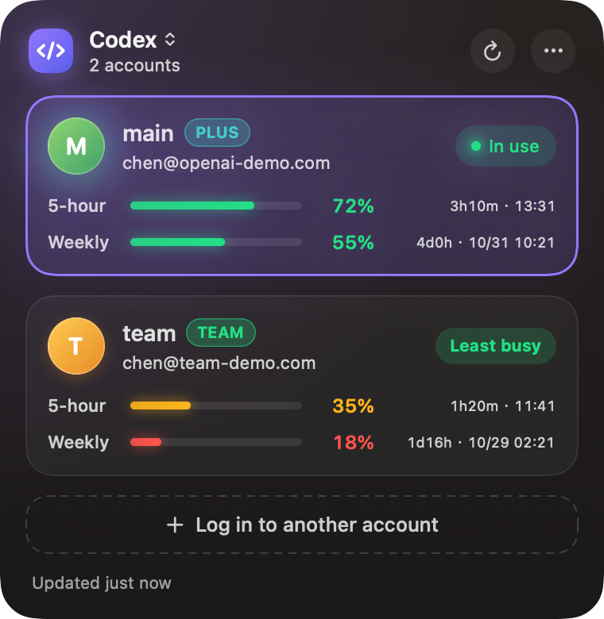

<div align="center">

# SwitchBoard

**A menu bar app for macOS that keeps all your Claude and Codex accounts one click away — and shows how much quota each one has left.**

English · [简体中文](README.zh-CN.md)

[](https://github.com/chenbstack/switchboard/releases/latest)


 

<sub>Screenshots use demo data.</sub>

</div>

## Features

- **One-click account switching** for [Claude Code](https://claude.com/claude-code) and [Codex](https://github.com/openai/codex). New sessions pick up the new account immediately.
- **Live quota for every account** — the 5-hour and weekly windows, with the remaining percentage and the reset time.
- **Menu bar gauge** — a double ring shows the active account's 5-hour (outer) and weekly (inner) quota at a glance.
- **Switch suggestions / auto-switch** — when the active account is nearly out of quota, or another account has weekly quota about to expire unused, SwitchBoard suggests (popup) or performs a switch by priority. Off by default.
- **Claude Desktop sync** — optionally switch the Claude desktop app to the same account.
- **Add accounts in place** — save your current login, or sign in to another account without touching the one you're using.
- **Cached quota** — the last known numbers show instantly on launch; refreshes run one account at a time.
- **Auto-update** — an *Update* button appears in the panel when a new release is out. One click and it restarts on the new version.
- **English & 简体中文** UI — follows your system language, or pick one in the ⋯ menu.
- Launch at login, dark UI that follows the active provider's accent colour.

## Install

1. Download the latest **`SwitchBoard-x.y.z.dmg`** from the [Releases](https://github.com/chenbstack/switchboard/releases/latest) page.
2. Open it and drag **SwitchBoard** into **Applications**.
3. Launch it — a gauge icon appears in the menu bar.

> The app is ad-hoc signed, not notarized. If macOS says it can't verify the developer, right-click the app → **Open** (once).

Requires macOS 14 or later.

## Usage

1. Log in to Claude Code / Codex as you normally do, then click the menu bar icon. SwitchBoard offers to **add the current account**.
2. To add more accounts, press **Log in to another account** and finish the browser login.
3. Click any account card to switch to it. Restart already-open IDEs / Codex sessions to pick up the change.
4. Use the provider switcher at the top-left of the panel to flip between **Claude** and **Codex**.
5. The **⋯** menu has launch-at-login, Claude Desktop sync, **Check for updates** and Quit.

> **Codex note:** SwitchBoard reads `~/.codex/auth.json`. If your Codex stores credentials only in the keychain, set `cli_auth_credentials_store = "file"` in `~/.codex/config.toml` and log in again.

## Switch suggestions & auto-switch

Pick a mode in **⋯ → Account switching → Mode**: **Off** (default), **Suggest** (a small popup under the menu bar icon shows the current and the suggested account's quota and reset times, and you confirm), or **Auto-switch** (switches right away and sends a notification). Claude and Codex are evaluated separately; nothing happens while a custom API / relay account is active.

**When it switches**

1. **Quota nearly used up** — the active account's 5-hour or weekly quota drops to the *Switch away below* value (default 5%) and another account that is usable right now has clearly more. If the exhausted window resets within 15 minutes, it waits instead.
2. **Weekly quota about to expire** — another account has unused weekly quota that is about to reset, and its "expiring" part reaches *Switch to expiring quota ≥* (default 25%), so it is used first. If the active account has expiring quota too, it only switches when the target's weekly quota expires *earlier* — so it never ping-pongs.

*Expiring quota* = weekly remaining % − (share of the weekly window left × 100), i.e. what would go unused if you burned quota evenly.

**How accounts are ranked**: accounts that are usable now (≥ 30% available) come first; then those whose expiring quota meets the threshold, earliest weekly reset first; the rest by `2 × expiring + 0.5 × available`. Windows that reset within 60 minutes are ranked as if already reset (100%), but it only switches once the account is actually usable.

At least 10 minutes between switches; *Dismiss* mutes the same account and reason for 1 hour. Checks run after every quota refresh.

> A switch affects new sessions only — restart open ones. After switching accounts, old sessions may show a "Claude can't use thinking from another organization" notice; it only costs some extra tokens.

## How it works & privacy

- Account credentials are stored in a **single macOS Keychain item** (`SwitchBoard` / `vault`). Account metadata and the quota cache live in `~/Library/Application Support/SwitchBoard/` (the cache holds percentages and reset times only).
- Switching an account writes that account's login into the place the CLI already reads (`~/.claude.json` / `~/.codex/auth.json`) and takes care of rotating refresh tokens.
- Quota is fetched from the same endpoints the official CLIs use for `/usage`. No third-party servers are involved; the only other network call is checking GitHub Releases for updates.
- Nothing is uploaded anywhere.

## Build from source

Needs Xcode (the SwiftUI macros require the full toolchain).

```bash
git clone https://github.com/chenbstack/switchboard.git
cd switchboard
./build.sh                 # → build/SwitchBoard.app
open build/SwitchBoard.app
```

Handy flags for development:

```bash
build/SwitchBoard.app/Contents/MacOS/SwitchBoard --demo --show   # fake data, open the panel on launch
build/SwitchBoard.app/Contents/MacOS/SwitchBoard --demo --snapshot out.png   # render the panel to a PNG
```

Releases are built by GitHub Actions: pushing a `v*` tag builds the app, packages a `.dmg` (for installing) and a `.zip` (used by the in-app updater), and publishes them as a GitHub Release.

## Disclaimer

SwitchBoard is an independent tool and is not affiliated with Anthropic or OpenAI. Claude and Codex are trademarks of their respective owners. Use it with accounts you own and in line with each provider's terms.
