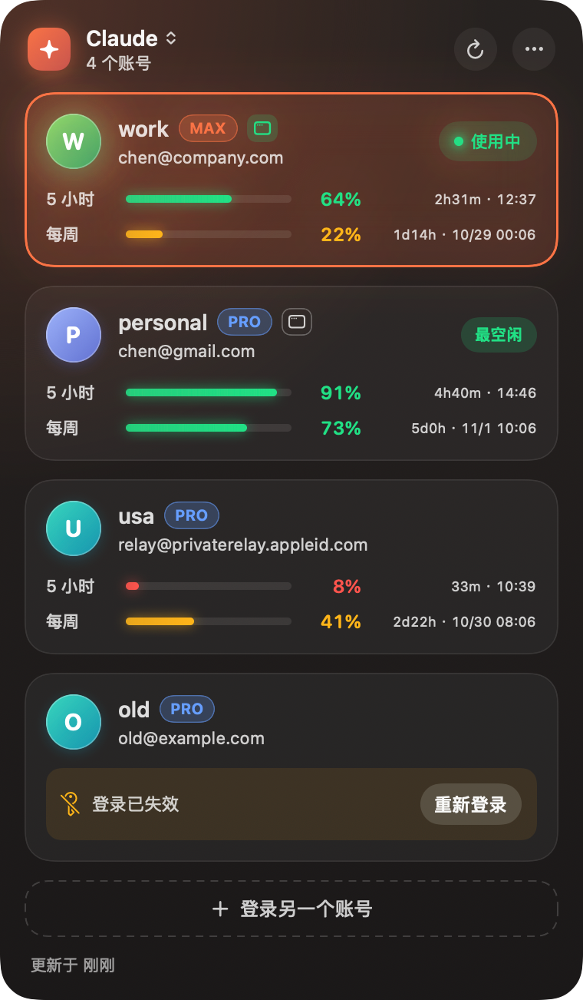

<div align="center">

# SwitchBoard

**A menu bar app for macOS that keeps all your Claude and Codex accounts one click away — and shows how much quota each one has left.**

English · [简体中文](README.zh-CN.md)

[](https://github.com/chenbstack/switchboard/releases/latest)


 

<sub>Screenshots use demo data.</sub>

</div>

## Features

- **One-click account switching** for [Claude Code](https://claude.com/claude-code) and [Codex](https://github.com/openai/codex). New sessions pick up the new account immediately.
- **Live quota for every account** — the 5-hour and weekly windows, with the remaining percentage and the reset time. The account with the most headroom is flagged *least busy*.
- **Menu bar gauge** — a double ring shows the active account's 5-hour (outer) and weekly (inner) quota at a glance.
- **Claude Desktop sync** — optionally switch the Claude desktop app to the same account.
- **Add accounts in place** — save your current login, or sign in to another account without touching the one you're using.
- **Cached quota** — the last known numbers show instantly on launch; refreshes run one account at a time.
- **Auto-update** — an *Update* button appears in the panel when a new release is out. One click and it restarts on the new version.
- Launch at login, dark UI that follows the active provider's accent colour.

## Install

1. Download the latest **`SwitchBoard-x.y.z.dmg`** from the [Releases](https://github.com/chenbstack/switchboard/releases/latest) page.
2. Open it and drag **SwitchBoard** into **Applications**.
3. Launch it — a gauge icon appears in the menu bar.

> The app is ad-hoc signed, not notarized. If macOS says it can't verify the developer, right-click the app → **Open** (once).

Requires macOS 14 or later.

## Usage

1. Log in to Claude Code / Codex as you normally do, then click the menu bar icon. SwitchBoard offers to **add the current account**.
2. To add more accounts, press **Log in to another account** and finish the browser login.
3. Click any account card to switch to it. Restart already-open IDEs / Codex sessions to pick up the change.
4. Use the provider switcher at the top-left of the panel to flip between **Claude** and **Codex**.
5. The **⋯** menu has launch-at-login, Claude Desktop sync, **Check for updates** and Quit.

> **Codex note:** SwitchBoard reads `~/.codex/auth.json`. If your Codex stores credentials only in the keychain, set `cli_auth_credentials_store = "file"` in `~/.codex/config.toml` and log in again.

## How it works & privacy

- Account credentials are stored in a **single macOS Keychain item** (`SwitchBoard` / `vault`). Account metadata and the quota cache live in `~/Library/Application Support/SwitchBoard/` (the cache holds percentages and reset times only).
- Switching an account writes that account's login into the place the CLI already reads (`~/.claude.json` / `~/.codex/auth.json`) and takes care of rotating refresh tokens.
- Quota is fetched from the same endpoints the official CLIs use for `/usage`. No third-party servers are involved; the only other network call is checking GitHub Releases for updates.
- Nothing is uploaded anywhere.

## Build from source

Needs Xcode (the SwiftUI macros require the full toolchain).

```bash
git clone https://github.com/chenbstack/switchboard.git
cd switchboard
./build.sh                 # → build/SwitchBoard.app
open build/SwitchBoard.app
```

Handy flags for development:

```bash
build/SwitchBoard.app/Contents/MacOS/SwitchBoard --demo --show   # fake data, open the panel on launch
build/SwitchBoard.app/Contents/MacOS/SwitchBoard --demo --snapshot out.png   # render the panel to a PNG
```

Releases are built by GitHub Actions: pushing a `v*` tag builds the app, packages a `.dmg` (for installing) and a `.zip` (used by the in-app updater), and publishes them as a GitHub Release.

## Disclaimer

SwitchBoard is an independent tool and is not affiliated with Anthropic or OpenAI. Claude and Codex are trademarks of their respective owners. Use it with accounts you own and in line with each provider's terms.
