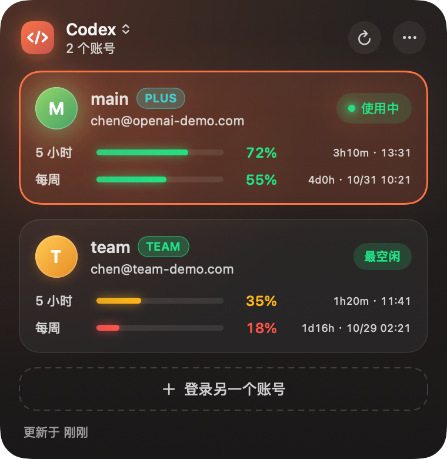

<div align="center">

# SwitchBoard

**macOS 菜单栏工具：一键切换多个 Claude / Codex 账号，并实时显示每个账号的剩余额度。**

[English](README.md) · 简体中文

[](https://github.com/chenbstack/switchboard/releases/latest)


 

<sub>截图为演示数据。</sub>

</div>

## 功能

- **一键切换账号**：支持 [Claude Code](https://claude.com/claude-code) 和 [Codex](https://github.com/openai/codex)，新开的会话立即使用新账号。
- **所有账号的实时额度**：5 小时窗口和每周窗口，显示剩余百分比与重置时间，额度最充裕的账号会标记为「最空闲」。
- **菜单栏仪表**：同心双环一眼看清当前账号的 5 小时（外环）和每周（内环）剩余额度。
- **Claude 桌面端同步**：切换账号时可选同步切换 Claude 桌面端。
- **就地添加账号**：保存当前登录的账号，或登录另一个账号而不影响正在使用的账号。
- **额度缓存**：启动时先显示上次的数据，刷新时逐个账号串行请求。
- **自动更新**：有新版本时面板右上角出现「更新」按钮，点一下即可升级并自动重启。
- **中英双语界面**：默认跟随系统语言，也可以在 ⋯ 菜单里手动切换。
- 支持开机启动；深色界面，主题色随当前服务（Claude / Codex）变化。

## 安装

1. 在 [Releases](https://github.com/chenbstack/switchboard/releases/latest) 页面下载最新的 **`SwitchBoard-x.y.z.dmg`**。
2. 打开 dmg，把 **SwitchBoard** 拖进 **Applications**。
3. 启动后菜单栏会出现仪表图标。

> 应用使用 ad-hoc 签名，未经过 Apple 公证。如果 macOS 提示无法验证开发者，请右键点击应用 → **打开**（只需一次）。

系统要求：macOS 14 或更高。

## 使用

1. 照常登录 Claude Code / Codex，然后点击菜单栏图标，SwitchBoard 会提示**添加当前账号**。
2. 想添加更多账号，点「登录另一个账号」并在浏览器中完成登录。
3. 点击任意账号卡片即可切换。已经打开的 IDE / Codex 会话需要重启才会生效。
4. 面板左上角的服务切换器可以在 **Claude** 和 **Codex** 之间切换。
5. **⋯** 菜单里有开机启动、Claude 桌面端同步、**检查更新**和退出。

> **Codex 说明：** SwitchBoard 读取 `~/.codex/auth.json`。如果你的 Codex 把登录只存在钥匙串里，请在 `~/.codex/config.toml` 中设置 `cli_auth_credentials_store = "file"` 并重新登录。

## 工作原理与隐私

- 所有账号的凭证合并存放在**一条 macOS 钥匙串条目**里（`SwitchBoard` / `vault`）。账号元数据和额度缓存位于 `~/Library/Application Support/SwitchBoard/`（缓存里只有百分比和重置时间）。
- 切换账号时，会把目标账号的登录写入 CLI 本来就读取的位置（`~/.claude.json` / `~/.codex/auth.json`），并处理 refresh token 的轮换。
- 额度来自官方 CLI `/usage` 所用的同一批接口，不经过任何第三方服务器；唯一的其他网络请求是向 GitHub Releases 检查更新。
- 不会上传任何数据。

## 从源码构建

需要安装 Xcode（SwiftUI 宏依赖完整工具链）。

```bash
git clone https://github.com/chenbstack/switchboard.git
cd switchboard
./build.sh                 # → build/SwitchBoard.app
open build/SwitchBoard.app
```

开发时常用的启动参数：

```bash
build/SwitchBoard.app/Contents/MacOS/SwitchBoard --demo --show   # 使用示例数据，启动即展开面板
build/SwitchBoard.app/Contents/MacOS/SwitchBoard --demo --snapshot out.png   # 把面板渲染成 PNG
```

发布由 GitHub Actions 完成：推送 `v*` tag 后会自动构建应用，打包 `.dmg`（用于安装）和 `.zip`（供应用内更新使用），并发布为 GitHub Release。

## 免责声明

SwitchBoard 是独立的第三方工具，与 Anthropic、OpenAI 无任何关联。Claude、Codex 是其各自所有者的商标。请仅对你自己的账号使用，并遵守各服务商的使用条款。
